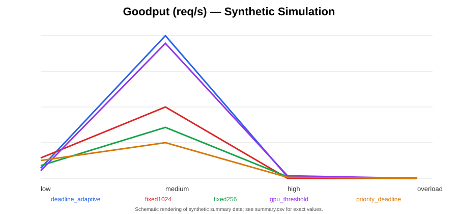
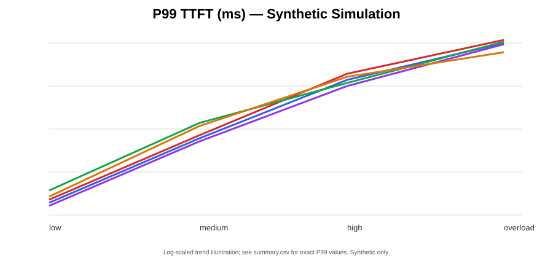
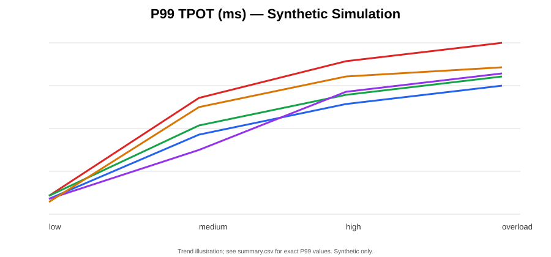

# 单实例 LLM 推理建模与仿真

本目录围绕 2×RTX 3090、TP=2、Qwen3-32B 的目标配置，构建 Request-level 与 System-level 两层调度的离散事件仿真基线。

> **数据口径：** 当前运行结果来自合成 Request Trace 和解析式 SyntheticCostModel，不是 RTX 3090 / Qwen3-32B 的真实实测或 profiling。所有曲线都仅用于策略机制与边界行为研究。

## 项目结构

- `single_instance_sim.py`：仿真主程序。
- `requirements.txt`：依赖。
- `papers/`：DRLServe、RAD&SLAI、SLOWEAVE 阅读笔记。
- `results/`：CSV 指标与 SVG 曲线。
- `third_party/LLMServingSim`：上游 LLMServingSim Git submodule。

## 调度拆分

- **Request-level**：在 Waiting Queue 中选择优先服务的请求，状态包括 TTFT、TPOT/TBT、Prompt 剩余长度、Decode 剩余长度、已生成 token 和 Prefill 进度。
- **System-level**：根据 Decode Batch、运行时延、deadline slack 与资源压力选择 Prefill Chunk Size / Token Budget。
- **联合目标**：最大化满足 TTFT 与 TPOT SLO 的 Goodput，而不是只最大化原始吞吐。

## 当前五种策略

| 策略 | Request 选择 | Chunk 决策 |
|---|---|---|
| fixed256 | FCFS | 固定 256 |
| fixed1024 | FCFS | 固定 1024 |
| gpu_threshold | FCFS | 根据利用率代理量切换 256/1024 |
| deadline_adaptive | FCFS | 根据 TPOT slack 二分搜索 Chunk |
| priority_deadline | 简化 Priority | 固定 512 |

这些是可解释基线。它们不是 DRLServe、RAD&SLAI 或 SLOWEAVE 的完整论文复现。

## 运行

```bash
pip install -r requirements.txt
python single_instance_sim.py --horizon 45 --seeds 5 --out results
```

## 结果图







精确数值以 `results/summary.csv` 为准。图中的趋势仅为合成模型结果。

## 论文笔记

- [DRLServe](papers/DRLServe_notes.md)
- [RAD & SLAI](papers/RAD_SLAI_notes.md)
- [SLOWEAVE](papers/SLOWEAVE_notes.md)

## 上游源码

LLMServingSim 通过 Git submodule 引入，避免把第三方完整代码副本误认为本项目原创：

```bash
git clone --recurse-submodules https://github.com/shawnke2025-NUS/Alibaba.git
```

上游项目：[casys-kaist/LLMServingSim](https://github.com/casys-kaist/LLMServingSim)。

## 真实 Profiling 迁移

1. 在目标 2×3090、TP=2 环境采集 Decode-only、Prefill-only 和 Mixed iteration。
2. 以 active decode batch、prefill chunk、cached context 为 mesh dimensions。
3. 每个 mesh point 重复运行，记录 P50/P99，并检查测量一致性。
4. 建立 P99 lookup/interpolation 或 Random Forest predictor。
5. 替换 `SyntheticCostModel.predict`，用真实运行 trace 验证 TTFT、TPOT、Goodput 和 deadline miss。

当前合成成本模型不能用于声称真实硬件吞吐、时延或 GPU 利用率。
